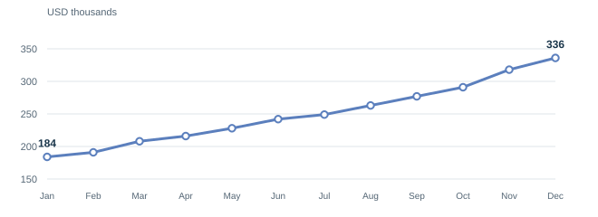

<p align="center">
  <picture>
    <source media="(prefers-color-scheme: dark)" srcset="assets/wordmark-dark.svg">
    <source media="(prefers-color-scheme: light)" srcset="assets/wordmark-light.svg">
    
  </picture>
</p>

<h1 align="center">Data visualization for coding agents</h1>

<p align="center"><a href="#install-the-skill">Install</a> · <a href="https://anyviz.aiware.store/">Website</a> · <a href="https://anyviz.aiware.store/llms.txt">llms.txt</a> · <a href="README.zh-CN.md" lang="zh-CN">简体中文</a></p>

Give your agent the data, the question and the audience. Leave it to the agent to decide whether a chart would help. When it would, **AnyViz** guides the agent through choosing the chart, drawing it with the tools in your project, and explaining the choice. You don’t have to pick a chart type or write a configuration.

## One CSV, two answers

Take the [twelve months of sales](examples/report-studio/data/monthly.csv) in the synthetic FY 2025 example.

> How much revenue did we book last year?

**$3,003,000.** For someone checking a number, that’s the whole answer.

> I’m writing the annual review. Was the stronger second half a single jump, or did sales build throughout the year?

**Revenue rose every month**, from $184,000 in January to $336,000 in December. H2 revenue was 36.6% above H1. Here the monthly line earns its place: the two half-year totals alone can’t tell you the shape of the climb.

<a href="https://anyviz.aiware.store/examples/report-studio/"></a>

Now ask which channel earned the most. Monthly totals can’t answer that question. The [channel breakdown](examples/report-studio/data/channels.csv) can: [ranked bars with a zero baseline](examples/report-studio/charts/channels.svg) put Direct first at 42.0% of annual revenue.

[Read the three-page report](https://anyviz.aiware.store/examples/report-studio/) · [PDF](examples/report-studio/report.pdf) · [Word](examples/report-studio/report.docx) · [Data, brief and source](examples/report-studio/)

This is a hand-authored, reproducible reference, not a recorded AI run. A different audience calls for a different output: the [retail operations dashboard](https://anyviz.aiware.store/examples/ecommerce-retail/) uses its own simulated data to put sales, conversion and product rankings on one interactive screen. Its [source](examples/ecommerce-retail/) is included.

## Install the skill

Get a checkout of `main`:

```sh
git clone --depth 1 --branch main https://github.com/TseringYuu/anyviz.git
cd anyviz
```

Review the installer before executing it: [macOS / Linux](install.sh) · [Windows](install.ps1). From the checkout, run **one** command for your platform:

| macOS / Linux | Windows PowerShell |
| --- | --- |
| `sh ./install.sh` | `.\install.ps1` |

The installer writes the shared skill at `~/.agents/skills/anyviz` and checks for supported agent-specific directories. Restart an agent that was already running. To try the skill without installing it globally, open the checkout in your agent and ask it to read [`SKILL.md`](SKILL.md).

**Try this from the checkout:**

```text
Use AnyViz with examples/report-studio/data/monthly.csv. I’m briefing the sales team.
Did revenue and average order value move together? Show the team what matters,
and tell us what these monthly totals can’t explain.
```

### Which download do I need?

- **For an agent, use the installers on `main`.** They verify a pinned archive’s SHA-256 before extraction. The installers in the [v1.0.3 GitHub release](https://github.com/TseringYuu/anyviz/releases/tag/v1.0.3) predate that check and fetch a moving branch. [How the installer pins work](docs/installer-security.md).
- **For JavaScript,** `npm install anyviz` provides themes, guides and specifications. The [1.0.2 npm package](https://registry.npmjs.org/anyviz/1.0.2) does not contain the shell or PowerShell installer. Installing the npm package does not register an agent skill.

## Reproduce the example

From the same checkout, these commands rebuild the HTML and six SVG figures from the CSV files, then serve them locally. Only Python 3’s standard library is needed:

```sh
python3 examples/report-studio/build.py
python3 -m http.server 8000 --bind 127.0.0.1
```

Open [the local report](http://127.0.0.1:8000/examples/report-studio/). The generator checks that channel and regional totals reconcile. The [export notes](examples/report-studio/README.md) cover PDF and Word; the Word text is editable, while its figures are images. The separate [industry dashboards](examples/) use ECharts from a CDN.

## Inside AnyViz

| When the agent needs to… | Where it looks |
| --- | --- |
| Choose a comparison, trend, map or flow | [Chart selection](guides/chart-selection.md) and [34 templates](templates/) |
| Fit a paper, report, dashboard or web product | [Four themes](aesthetics/themes/) and [publication guidance](guides/academic-publication.md) |
| Produce runnable code in the project’s stack | [Seven adapters](adapters/): D3, ECharts, Mapbox, Three.js, Plotly, Matplotlib and ggplot2 |
| Check the result at its final size | [Consistency](guides/consistency-rules.md), [legends](guides/legend-layout.md) and [accessibility](guides/accessibility.md) |

The skill supplies the rules; **your agent and its tools do the rendering**. Review the figures against your source data before publication.

[Contributing](CONTRIBUTING.md) · [Security](SECURITY.md) · [MIT license](LICENSE)
