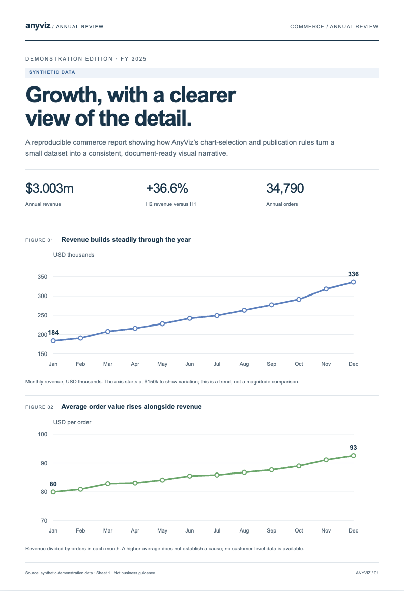
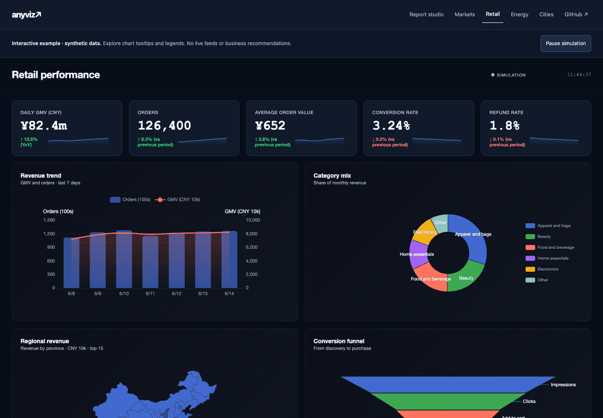

<p align="center"></p>

<h1 align="center">Charts that belong in the document.</h1>

<p align="center">An open-source visualization skill for AI coding agents.<br>Choose the right chart. Keep every figure coherent. Make the final page readable.</p>

<p align="center"><b>English</b> · <a href="README.zh-CN.md">简体中文</a> · <a href="https://anyviz.aiware.store">Website</a> · <a href="examples/">Examples</a></p>
<p align="center"><a href="LICENSE"></a> <a href="https://www.npmjs.com/package/anyviz"></a> <a href="SKILL.md"></a></p>

## See the work first

**A chart can look good in isolation and still fail on the page.** AnyViz gives an agent guidance for chart choice, typography, color, legends, captions, and consistent multi-chart layouts. The goal is not more decoration: it is a figure the reader can actually use.

Start with **[Report Studio](examples/report-studio/)**, a document-oriented example, then explore the four industry dashboards. Inspect the data and implementation rather than taking a marketing claim on trust.

[](examples/report-studio/report.pdf)

[Read the actual PDF](examples/report-studio/report.pdf) · [Explore the source and reproduction steps](examples/report-studio/)

| Make something useful | Explore |
| --- | --- |
| Figures for a report or research document | [Report Studio](examples/report-studio/) · [Publication guide](guides/academic-publication.md) |
| Retail performance overview | [Retail dashboard](examples/ecommerce-retail/) |
| Financial monitoring layout | [Trading dashboard](examples/finance-trading/) |
| Energy and device monitoring | [Energy dashboard](examples/iot-energy/) |
| Geographic and urban analysis | [City dashboard](examples/city-geo/) |

Dashboard previews below use simulated data, not live services or customer deployments.



## What changes with AnyViz?

Your agent already knows how to write chart code. AnyViz supplies a reusable set of design decisions:

- **Choose for the question.** Comparison, trend, distribution, relationship, composition, geography, hierarchy, or flow: start with the reader's task, not a chart type.
- **Design for the destination.** A report needs readable type at its final physical size; a dashboard needs hierarchy and responsive layout. Four themes cover different contexts.
- **Keep figures consistent.** Reuse entity colors, units, number formats, type scales, and spacing across a document or canvas.
- **Check the finished page.** Avoid duplicated captions and sources, crowded legends, awkward alignment, and color-only distinctions. Review the actual export, not just the source code.

These are specifications, templates, and workflow instructions, **not a new rendering engine or an autonomous PDF/Word converter**. Your agent and its tools generate the result. Model behavior varies; inspect the data, code, and final output before publishing. The examples are demonstrations, not a controlled benchmark or a promise of publication acceptance.

## Get started

### 1. Add the skill to your agent

On macOS or Linux, download the installer, review it, then run it:

```sh
curl -fsSL https://raw.githubusercontent.com/TseringYuu/anyviz/main/install.sh -o /tmp/anyviz-install.sh
less /tmp/anyviz-install.sh
sh /tmp/anyviz-install.sh
```

On Windows PowerShell:

```powershell
Invoke-WebRequest https://raw.githubusercontent.com/TseringYuu/anyviz/main/install.ps1 -OutFile anyviz-install.ps1
Get-Content ./anyviz-install.ps1
./anyviz-install.ps1
```

The installer detects supported agent skill directories and installs a shared copy. An unmanaged existing skill is backed up before replacement. See [install.sh](install.sh) and [install.ps1](install.ps1) for the exact behavior. Run again to update.

Prefer manual setup? Clone the repository and ask your assistant to read [`SKILL.md`](SKILL.md), following your agent's instructions for loading custom skills.

### 2. Give it a concrete brief

```text
Read AnyViz's SKILL.md and the academic publication guide.
Use this CSV to create figures for an A4 research report.
Keep colors and units consistent across figures. Place captions and sources
outside the plots, avoid overlapping legends, and check readability at the
final document size. Export SVG where supported and a PDF preview.
Explain chart choices and flag missing or uncertain data. Do not invent data.
```

For a dashboard, specify its audience, key question, stack, and screen size instead. AnyViz's [customization guide](guides/customization-guide.md) maps requests such as “academic,” “larger labels,” or “move the legend” to design parameters.

### 3. Inspect and iterate

Check values against the source, units and axes, label collisions, contrast, and the final exported layout. Ask the agent to fix what you can see. For a reproducible starting point, use the [examples](examples/).

## Inside the skill

**Analyze → Aesthetics → Adapt → Consistency → Accessibility**

| Resource | What it provides |
| --- | --- |
| [34 templates](templates/) | 20 statistical charts, 3 maps, 8 relational/hierarchical charts, and 3 three-dimensional charts |
| [4 themes](aesthetics/themes/) | Modern, analytics, dashboard, and academic |
| [7 stack adapters](adapters/) | D3, ECharts, Mapbox, Three.js, Plotly, Matplotlib, and ggplot2 |
| [Chart selection](guides/chart-selection.md) | Data shape and analytical intent → chart choice |
| [Publication rules](guides/academic-publication.md) | Figure size, captions, source notes, grayscale, and export guidance |
| [Legend layout](guides/legend-layout.md) | Safe spacing, collision checks, and visual centering |
| [Consistency](guides/consistency-rules.md) | Shared colors, formats, typography, and spacing |
| [Accessibility](guides/accessibility.md) | Contrast, redundant encoding, and text alternatives |

Adapters are guidance for the named libraries; install the rendering libraries your project needs separately. Map services may require their own credentials. See each adapter for requirements.

## Use the specifications without an agent

The npm package exposes JSON themes and paths to the guides. It does not render charts itself.

```sh
npm install anyviz
```

```js
const anyviz = require('anyviz');
const theme = anyviz.themes.academic();
console.log(theme.publication.export.dpi_min);
console.log(anyviz.guides.academicPublication);
```

Or read [`aesthetics/default.json`](aesthetics/default.json) directly from your preferred language.

## Run and verify locally

```sh
git clone https://github.com/TseringYuu/anyviz.git
cd anyviz
python3 -m http.server 8000
# Open http://localhost:8000/examples/report-studio/
```

The legacy dashboard examples load ECharts from a CDN; internet access is required for that dependency. Their numbers are simulated. See each example's README for its scope and run instructions.

```sh
npm run validate
```

Validation checks theme configuration, package exports, and installer behavior. It is not a visual correctness test: inspect rendered figures and documents too.

## Help shape the next example

Using AnyViz in a report, paper, or dashboard? [Share an issue](https://github.com/TseringYuu/anyviz/issues) with a sanitized screenshot, your agent/model, the prompt, and what worked or failed. Please do not upload private data. Reproducible examples and honest feedback are especially useful.

**If this belongs in your toolkit, star the repository to keep it close.** No account or star is required to use the examples.

Contributions: [guide](CONTRIBUTING.md) · [code of conduct](CODE_OF_CONDUCT.md) · [security](SECURITY.md).

## License and foundations

[MIT](LICENSE). The design guidance draws on Edward Tufte's data-ink principles, Nathan Yau's data storytelling, ColorBrewer palettes, and Viridis. These influences are not endorsements or certifications.
