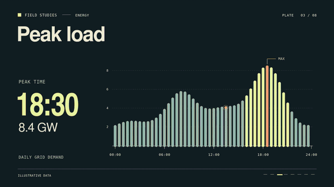

<p align="center">
  <picture>
    <source media="(prefers-color-scheme: dark)" srcset="assets/wordmark-dark.svg">
    <source media="(prefers-color-scheme: light)" srcset="assets/wordmark-light.svg">
    
  </picture>
</p>

<h1 align="center">给编程智能体用的数据可视化技能</h1>

<p align="center"><a href="#安装技能">安装</a> · <a href="https://anyviz.aiware.store/">官网</a> · <a href="https://anyviz.aiware.store/llms.txt">llms.txt</a> · <a href="README.md" lang="en">English</a></p>

把数据、你想弄清的问题，以及答案是给谁看的，告诉智能体就行。要不要画图，让它根据场景判断。需要画时，**AnyViz** 指导它选择图表，用项目里合适的工具画出来，并说明选择的理由。你不必先选图表类型，也不必写配置。

[](https://anyviz.aiware.store/showreel/)

[▶ 播放完整短片（22 秒）](https://anyviz.aiware.store/showreel/) · 可视化效果展示，非 AI 自主执行过程录像。

## 安装技能

将这一句复制给 AI：

```text
使用 anyviz「https://anyviz.aiware.store/llms.txt」创建数据可视化图表
```

**想让智能体持续使用这份技能？** 先用 Git 获取仓库：

```sh
git clone --depth 1 https://github.com/TseringYuu/anyviz.git
```

先查看下载的 `anyviz/install.sh`，再在 macOS / Linux 运行：

```sh
sh anyviz/install.sh
```

无需 Node.js 或 Python。安装后重启智能体。[Windows PowerShell](https://github.com/TseringYuu/anyviz/blob/093eebcfb7d8a4537d1a090f7423e93eee8529e8/install.ps1) · [安装与校验说明](docs/installer-security.md)

---

[官网](https://anyviz.aiware.store/) · [参与贡献](CONTRIBUTING.md) · [安全](SECURITY.md) · [MIT 许可](LICENSE)
