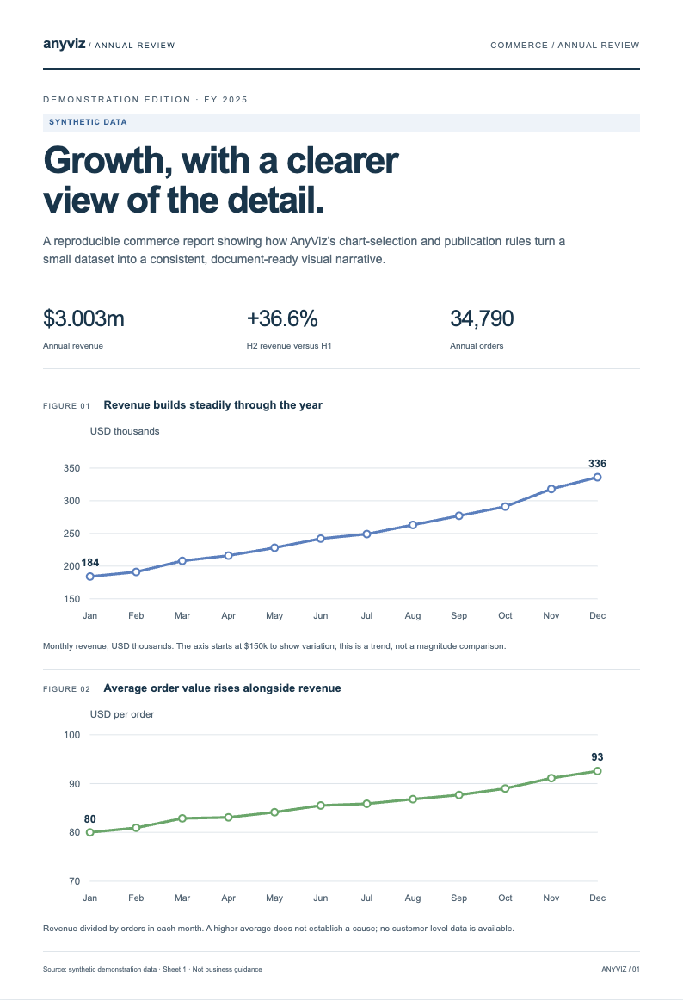

# Report Studio

**A complete document, not a chart floating on a blank canvas.** Six SVG charts in a three-page commerce report, with consistent type, units, captions, colors and explicit analytical limits.

[Open the live report](https://anyviz.aiware.store/examples/report-studio/) · [Download the PDF](report.pdf) · [Read the brief](PROMPT.md)



## Reproduce

From the repository root, with Python 3 (standard library only):

```sh
python3 examples/report-studio/build.py
python3 -m http.server 8080
```

Open `http://localhost:8080/examples/report-studio/`. Choose **Print report**, select A4, enable background graphics, and turn off browser headers/footers. The committed PDF was exported with headless Chrome; a PDF exporter is not needed to rebuild the HTML and SVGs.

For a reproducible PDF export, install the optional `pypdf` package in your Python environment, then run:

```sh
python3 examples/report-studio/export_pdf.py
```

The exporter uses installed Chrome on macOS, or `google-chrome` on Linux. Set `CHROME_BIN` for another executable path. It renders each page separately and merges them to avoid browser pagination differences. It fails if any report page overflows. `pypdf` and Chrome are only needed for this optional PDF export, not for the HTML/SVG build.

## What's real, and what's illustrative?

All business data is **synthetic**. This is a deterministic, authored reference implementation following AnyViz rules, not a recorded model benchmark, customer case study or proof of one-prompt generation. No baseline or improvement percentage is claimed. The example brief is a reusable prompt, not a fabricated generation transcript.

The generator reads the repository's actual Analytics theme. It follows [academic publication](../../guides/academic-publication.md), [legend layout](../../guides/legend-layout.md) and [chart selection](../../guides/chart-selection.md) guidance. Adaptations include a dark-blue editorial text color, direct labels and paired horizontal bars.

## Data contract

- `data/monthly.csv`: 12 synthetic months in FY 2025. Revenue is USD; orders are counts; gross margin, return rate and on-time rates are percentages. On-time rate is retained as an unused source field, not silently visualized.
- `data/channels.csv`: annual revenue by channel.
- `data/regions.csv`: regional revenue for H1 and H2.
- `build.py`: loads the CSVs, checks channel/regional reconciliation, computes annual orders and revenue, H2 growth and monthly average order value, then writes HTML and six standalone SVGs.

Revenue totals **$3,003,000** and orders total **34,790**. H2 revenue is **36.6%** greater than H1. Percent changes and channel shares are rounded. AOV = monthly revenue / monthly orders. The gross-margin 40% reference is illustrative, not an actual target.

## Publication decisions

| Question | Chart | Guardrail |
|---|---|---|
| How does revenue change? | Line with visible points | Truncated axis explicitly disclosed |
| How much per order? | Separate line chart | No dual axis or causal claim |
| Which channel is largest? | Ranked horizontal bars | Zero baseline; values and shares labeled |
| How do periods compare? | Paired horizontal bars | Identical baseline; period labels |
| How does margin change? | Line + dashed reference | Reference and truncated axis disclosed |
| How do returns change? | Line | Zero baseline; no implied causality |

The report keeps one caption and one source strategy. Every SVG has an accessible title, and the HTML images have descriptive alternatives. The PDF is three A4 pages with vector chart graphics. It is a visual export, not claimed as a fully tagged accessible PDF; use HTML and CSV for accessible data access.

## Verification

Rebuild with `python3 build.py`; inspect all three PDF pages after modifying layout. Check 390px and desktop widths, six loaded chart images, no horizontal page overflow, and totals reconciled by assertions. This sample does not require a CDN, network request, API key or charting-library installation to render.
